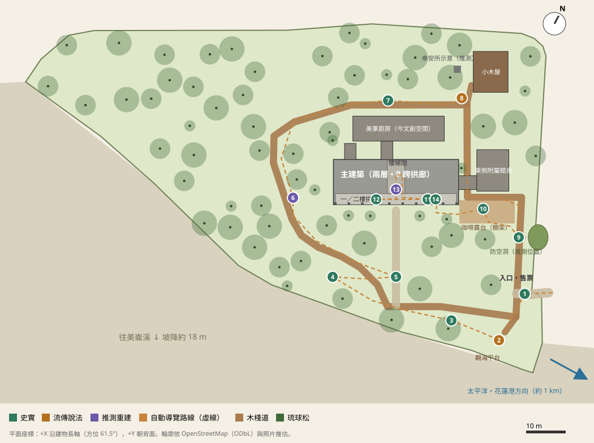
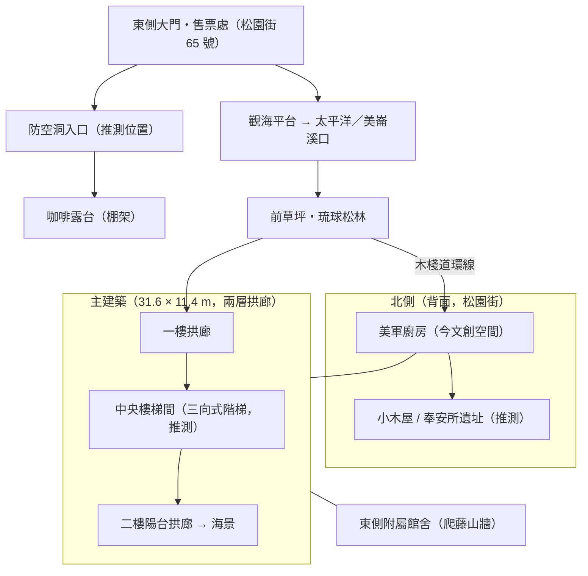

# SPACE_PLAN — 照片分析與空間整理

> 座標系統（全專案通用）：公尺，原點為主建築平面中心。**+X** 沿建物長軸（方位角 61.5°，東北偏東），**+Y** 朝建物背面（方位角 331.5°，西北偏北），Z 向上；z = 0 為草坪平台（海拔約 30 m）。three.js 世界座標 = `(X, Z, −Y)`。
> 配置數據唯一來源：[`blender/layout.json`](blender/layout.json)，建模腳本、平面圖、網站小地圖都讀這一份。

## 1. 逐張照片分析

| # | 推估拍攝位置（平面座標） | 朝向 | 看到的構件 | 對建模的用途 |
|---|---|---|---|---|
| 1 | 前草坪西南側 (−8, −32)，眼高 1.6 m | 西北偏北（約 340°），正對立面 | 二樓拱廊 7–8 跨與欄杆、灰色切妻屋頂、東端爬藤山牆、右側綠色棚架與白色躺椅、前景兩株斜幹琉球松 | 立面跨數、屋頂坡度約 24°、露台位置在東端前方 |
| 2 | 西端前方近處 (−20, −12) | 東北（沿立面透視） | 西側山牆（無拱，高處小窗，落水管）、一樓兩跨拱圈下的白色木門與氣窗、二樓欄杆（方柱短柱）、台基階、球形灌木 | **比例尺**：門高約 2.1 m；拱跨淨寬約 2.6–2.8 m；墩柱寬約 0.6 m；台基高約 0.45 m（三階） |
| 3 | 東側大門外 (39, −28) | 西北 | 兩根混凝土方門柱（約 1.0 × 1.0 × 2.2 m）、門牌「65」、館名牌、歷史建築標章、草坪上的「26」字裝置、主立面中段 | 入口位置與門柱造型 |
| 4 | 東南方近處 (24, −16) | 西北 | 東段兩跨與山牆滿佈爬藤；一樓拱三跨、白色格子窗；指標牌（女廁、樓梯、防空洞、二樓展場）；右下木棧道；人物（約 1.65 m） | 爬藤範圍、木棧道與指標位置；以人物身高校核：一樓拱頂約 3.7 m |
| 5 | 前草坪中央偏西 (−4, −30) | 北偏西 | 全長立面、東端爬藤、右側棚架、右前大松樹幹 | 跨數複核：二樓 9 跨（東段 2 跨被爬藤遮住） |
| 6 | 西南低處 (−26, −18)，仰角 | 東北 | 西山牆高窗、拱廊向深處遞減、強烈陽光 | 山牆開窗、屋簷出挑約 0.6 m |
| 7 | 二樓拱廊內 (6, −4.3, +4.45) | 西南偏西 | 白色木條天花與吊燈、圓拱＋實心矮牆欄杆（約 1 m）、廊寬約 2 m、盡頭窗、牆上詩句裝置；拱外是坡下樹冠 | 拱廊內部材質；**外側低於樓面**，代表正立面朝向下坡（美崙溪方向） |
| 8 | 同 7，略往內 | 西南偏西 | 房間側白框格子窗（3 × 4 小格）、展示 | 房間窗型 |
| 9 | 二樓拱廊西段 (−8, −4.3, +4.45) | 東北偏東 | 拱外草坪與松樹、遠處道路與停車、「太平洋詩歌節」展板 | 拱廊東端可看到入口與街道 |
| 10 | 前草坪西南角 (−30, −34)，廣角 | 東北 | 主建築全貌、東側爬藤山牆的單層附屬建物、多株高大斜幹琉球松（樹高推估 15–18 m，胸徑 0.5–0.7 m） | 附屬建物體量、松樹型態（斜幹、平展層狀樹冠） |

> 拍攝位置是由透視消失點、立面可見範圍及 OSM 輪廓反推，誤差約 ±5 m。照片只用於推估，不放進網站，也不當貼圖。

## 2. 整體配置平面圖

（`docs/plan.svg` 由 `python tools/make_plan.py` 依 `layout.json`、`content/hotspots.json` 與建模輸出的樹木位置自動產生。）

簡化示意（Mermaid）：

### 動線與方位
- **入口**：東側大門，位在 OSM 園區邊界的凹口 (35.6, −28.3)，面向松園街。售票亭在門內左側。
- **木棧道環線**：沿 OSM 步道 way 145564258 繞主建築一圈，距正立面約 25 m。東段會穿過東側通廊下方（OSM 標記為 building passage）。
- **前草坪**：主建築南南東側（−Y 方向），約 70 × 35 m，有疏落的大松。再往南園區邊界外就是陡坡，下到美崙溪河濱（高差約 18 m，依 ASTER DEM）。
- **海景方向**：太平洋大致在平面 (0.88, −0.48) 方向，約 1 km 外（從正立面看是右前方）。美崙溪出海口在 (0.33, −0.94) 方向，約 1.3 km。開場運鏡就從溪口方向推近。
- **背面**：一層的美軍廚房（OSM「Pine Garden Café」範圍）以連廊接主建築；更北側是小木屋，再往北就是松園街。

## 3. 尺寸推估

比例尺：門高 2.1 m、樓梯級高 17 cm、欄杆高約 1 m、人物身高 1.65 m；平面尺寸以 OSM 輪廓（由航照描繪，誤差約 ±0.5 m）為主。

| 項目 | 推估值 | 依據 |
|---|---|---|
| 主建築長 | **31.6 m** | OSM 正立面邊長 |
| 主建築寬（進深） | **11.4 m** | OSM 西端邊長 |
| 拱廊進深 | 2.8 m（含 0.6 m 墩柱，淨寬約 2.2 m） | 照片 7、8：廊寬約 2 m |
| 拱圈數 | 正立面每層 **9 跨**，一、二樓上下對齊 | 照片 1、4、5 |
| 開間（柱距） | **3.4 m**（墩柱 0.6 m、拱淨跨 2.8 m） | 9 × 3.4 + 兩端牆 0.5 = 31.6 m |
| 台基高 | 0.45 m（3 階 × 15 cm） | 照片 2 |
| 一樓拱 | 起拱 2.35 m、半圓拱半徑 1.4 m、拱頂 3.75 m（自台基面） | 門高比例＋人物 |
| 二樓樓板面 | +4.45 m（層高 4.0 m），樓板帶厚 0.32 m | 照片 1 的水平帶 |
| 二樓欄杆 | 0.95 m（短柱＋扶手） | 照片 7 |
| 簷高 | 8.4 m | 二樓拱頂 7.9 m＋梁帶 |
| 屋頂 | 切妻（雙坡），坡度約 24°，出簷 0.65 m，屋脊約 11 m | 照片 1、6 |
| 總高 | 約 11 m | 相當於約 5 個門高 |
| 東側附屬館舍 | 8.1 × 10.5 m，單層，簷高 4 m、脊高 6.6 m | OSM ＋照片 10 |
| 美軍廚房 | 23.1 × 6.3 m，單層 | OSM（標記為 Café） |
| 小木屋 | 8.8 × 10.3 m，高架地板 0.6 m | OSM ＋官網「高架地板」 |
| 琉球松 | 高 13–18 m、胸徑 0.4–0.7 m、斜幹 | 照片 1、10 |

## 4. 照片看不到、以其他資料補足的部分

| 區域 | 補足方式 | 標示 |
|---|---|---|
| 背立面 | 照片都沒拍到。依 OSM 輪廓（後側附屬間、連廊）＋同時期官廳常見做法（整齊開窗、無拱廊） | **推測重建** |
| 室內格局 | 只做中央樓梯間與拱廊。房間內部看不到，用門窗封閉 | **推測重建** |
| 三向式階梯 | 官網說二樓展場靠「三向式階梯」上下。形式不明，做成中央一跑上到平台、再左右分兩跑（三個方向）的軍用快速疏散梯 | **推測重建** |
| 防空洞 | 官網說「入園後步道右側」，入口做在東側步道旁的土丘 | **推測重建（位置）** |
| 奉安所 | 位置不明，在小木屋旁放石基座示意 | **推測重建** |
| 觀海平台 | 官網提到有觀海休憩平台，放在園區東南角的坡頂 | **推測重建（位置）** |
| 地形 | ASTER 30 m DEM 粗估：平台約 30 m，南側溪畔約 12 m | 簡化 |
| 遠景 | 海平面、海岸線、花蓮港防波堤、中央山脈剪影都用簡化幾何 | 簡化 |

## 5. 導覽熱點與建議路線

14 個熱點，內容在 [`content/hotspots.json`](content/hotspots.json)，路線在 [`content/tour.json`](content/tour.json)。

| 順序 | 熱點 | 類別 | 位置 |
|---|---|---|---|
| 1 | 入口與售票處 | 史實 | 東側大門 |
| 2 | 觀海平台與「御前酒」傳說 | 流傳說法 | 東南角坡頂 |
| 3 | 震災、風災與老松保存 | 史實 | 前草坪東南 |
| 4 | 琉球松林 | 史實 | 前草坪西南 |
| 5 | 主建築正立面 | 史實 | 前草坪中央 |
| 6 | 建築構造與屋瓦 | 推測重建 | 西側山牆 |
| 7 | 美軍顧問團招待所時期 | 史實 | 背面美軍廚房 |
| 8 | 小木屋與奉安所 | 流傳說法 | 東北小木屋 |
| 9 | 防空洞 | 史實（位置推測） | 東側步道旁 |
| 10 | 今日的藝文空間與咖啡露台 | 史實 | 東端棚架露台 |
| 11 | 一樓拱廊 | 史實 | 一樓拱廊 |
| 12 | 兵事部的功能 | 史實 | 中央樓梯間入口 |
| 13 | 三向式階梯 | 推測重建 | 中央樓梯間 |
| 14 | 二樓陽台海景（結語） | 史實 | 二樓拱廊東段 |

步行距離約 260 m。自動導覽步速 1.3 m/s，約 3.3 分鐘；每站停留 14–22 秒（依解說長度），合計約 **7 分鐘**。
